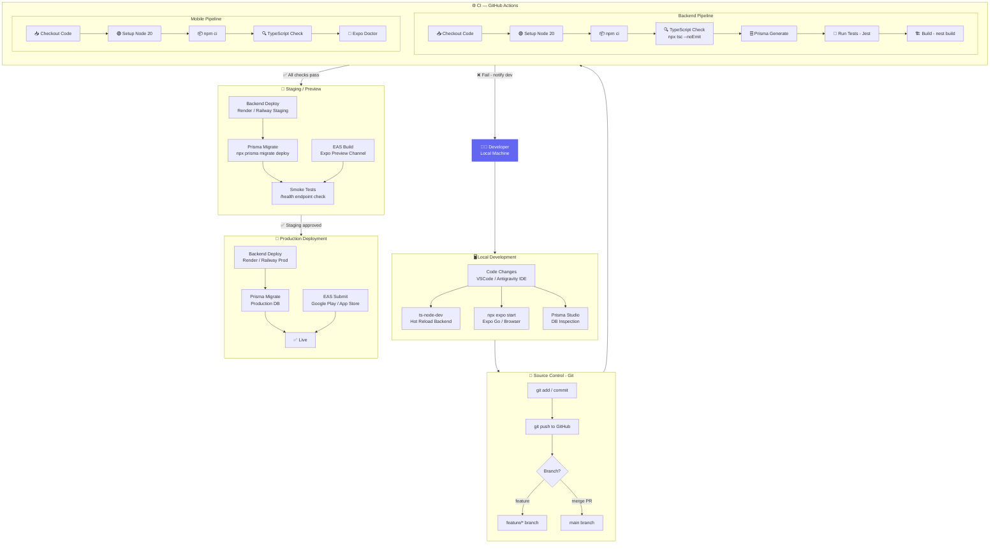
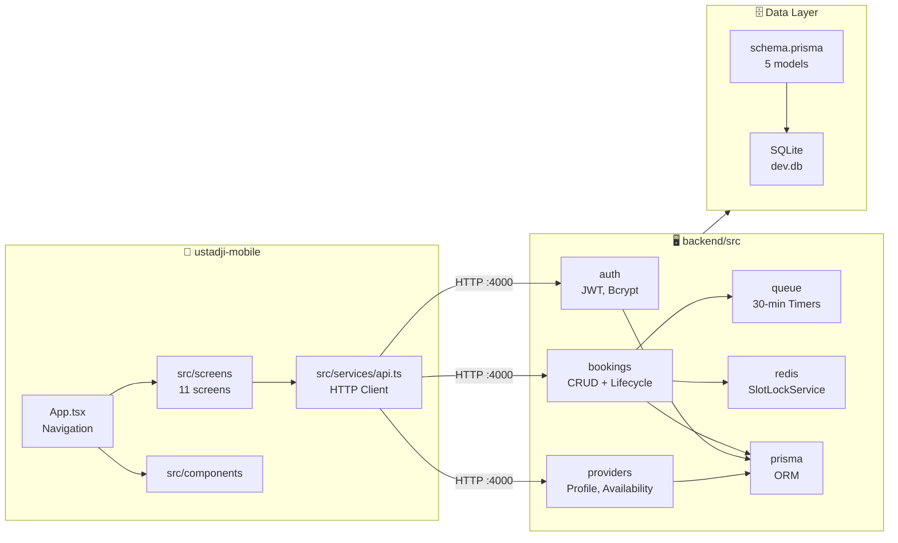

# 🚀 UstadJi — CI/CD Pipeline

> **Project**: UstadJi (FYP) — On-demand Home Services Platform  
> **Stack**: NestJS Backend · Expo React Native Mobile · Prisma/SQLite · Redis (optional)  
> **Repository**: `d:\FYP` (Git mono-repo)

---

## 📐 Pipeline Overview



---

## 🗂️ Stage-by-Stage Breakdown

### Stage 1 — Local Development

| Step | Tool | Purpose |
|------|------|---------|
| Code editing | VSCode / Antigravity IDE | TypeScript source editing |
| Backend hot-reload | `ts-node-dev --respawn` | Instant restart on file change |
| Mobile dev server | `npx expo start` | Live reload via Expo Go / Web |
| DB inspection | `npx prisma studio` | Browse & edit SQLite records |
| DB schema changes | `npx prisma db push` | Apply schema without migrations |

---

### Stage 2 — Source Control (Git)

```
main
  └── feature/booking-lifecycle
  └── feature/consumer-orders-ui
  └── feature/provider-pending-requests
  └── fix/slot-lock-try-catch
```

- All features developed on **feature branches**
- PRs merged to `main` only after local testing
- `.gitignore` excludes: `node_modules/`, `prisma/dev.db`, `.env`, `dist/`

---

### Stage 3 — CI (GitHub Actions)

#### `backend-ci.yml`

```yaml
name: Backend CI
on: [push, pull_request]
jobs:
  build:
    runs-on: ubuntu-latest
    steps:
      - uses: actions/checkout@v4
      - uses: actions/setup-node@v4
        with: { node-version: '20' }
      - run: cd backend && npm ci
      - run: cd backend && npx tsc --noEmit          # Type check
      - run: cd backend && npx prisma generate        # Generate Prisma client
      - run: cd backend && npm test                   # Jest unit tests
      - run: cd backend && npm run build              # Compile to dist/
```

#### `mobile-ci.yml`

```yaml
name: Mobile CI
on: [push, pull_request]
jobs:
  check:
    runs-on: ubuntu-latest
    steps:
      - uses: actions/checkout@v4
      - uses: actions/setup-node@v4
        with: { node-version: '20' }
      - run: cd ustadji-mobile && npm ci
      - run: cd ustadji-mobile && npx tsc --noEmit    # Type check
      - run: cd ustadji-mobile && npx expo-doctor      # Expo config validation
```

---

### Stage 4 — Staging Deployment

| Component | Platform | Command |
|-----------|----------|---------|
| NestJS Backend | **Render** / Railway | Auto-deploy from `main` |
| Database migration | Prisma | `npx prisma migrate deploy` |
| Mobile preview build | **EAS Build** (Expo) | `eas build --profile preview` |
| Health check | REST | `GET /health → 200 OK` |

> **Environment Variables (Staging)**:
> ```env
> DATABASE_URL=file:./staging.db
> JWT_SECRET=<staging-secret>
> REDIS_URL=redis://staging-redis:6379
> NODE_ENV=staging
> ```

---

### Stage 5 — Production Deployment

| Component | Platform | Notes |
|-----------|----------|-------|
| NestJS Backend | **Render** (Prod tier) | `node dist/main` |
| Database | **PostgreSQL** (Render DB) | Migrate from SQLite for prod |
| Mobile App | **EAS Submit** | Google Play / TestFlight |
| Slot Locking | **Redis** (Upstash) | Production Redis instance |
| Secrets | **Render Env Vars** / GitHub Secrets | Never committed to git |

---

## 🔒 Secrets Management

```
GitHub Secrets
├── EXPO_TOKEN              → EAS CLI authentication
├── RENDER_API_KEY          → Backend auto-deploy trigger
├── JWT_SECRET              → Auth token signing
├── DATABASE_URL            → Production DB connection string
└── REDIS_URL               → Upstash Redis URL
```

---

## 🏗️ Project Module Map



---

## 📊 Key Metrics

| Metric | Value |
|--------|-------|
| Backend port | `4000` |
| Mobile bundler | Expo Metro |
| DB ORM | Prisma v6 |
| Auth method | JWT (Bearer) |
| Slot lock TTL | 5 minutes |
| Booking response window | 30 minutes |
| Node version | 20 LTS |
| TypeScript | v5.7 (Backend) · v6.0 (Mobile) |

---

## 🛠️ Running Locally (Quick Reference)

```powershell
# Terminal 1 — Backend
cd d:\FYP\backend
npm start                          # ts-node src/main.ts → :4000

# Terminal 2 — Mobile
cd d:\FYP\ustadji-mobile
npx expo start                     # Metro bundler → scan QR with Expo Go

# Optional — DB GUI
cd d:\FYP\backend
npx prisma studio                  # Opens at http://localhost:5555
```
