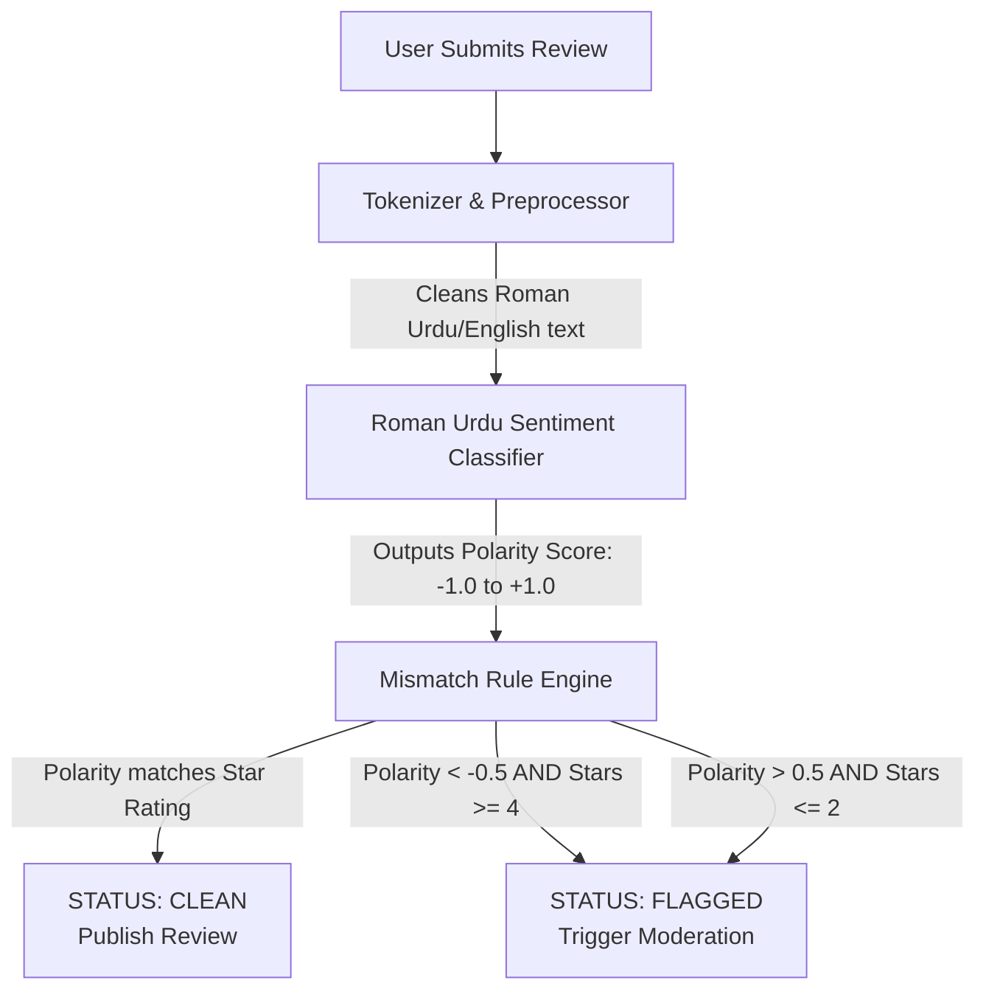

# Feature Specification: Fake Review & Mismatch Detection Engine (Trust & Safety Audit)

## 1. Feature Overview

The Fake Review & Mismatch Detection Engine protects marketplace integrity by dynamically auditing customer and service provider feedback before it affects public ratings or triggers escrow payouts. The system flags fraudulent activity, collusion, and **rating mismatches**—specifically instances where text feedback strongly contradicts the star rating (e.g., a customer writing *"Bohot kharab service, extremely late"* while giving 5 stars to boost a provider, or vice versa). The feature leverages open-source Roman Urdu sentiment datasets alongside public benchmark review corpora to build a localized, region-aware moderation model.

---

## 2. Data Sources & Engineering Logic

### A. Kaggle Public Benchmarks & Roman Urdu Corpora
To train and stress-test our rules engine offline prior to live platform transactions, we combine general review datasets with local language corpora:
* **Roman Urdu Sentiment Dataset:** Sourced labeled Roman Urdu text pairs (containing ground-truth labels like `Positive`, `Negative`, `Neutral`) to handle local code-mixing, regional slang (*"bekaar"*, *"zabarndast"*), and phonetically spelled sentiment strings.
* **Kaggle Review Datasets:** Public dumps (such as Yelp/Amazon product reviews) providing baseline `[review_text, star_rating]` structures for general English benchmarking.
* **Application:** Provides thousands of verified Roman Urdu and English samples to pre-train our text classifier. If the model's calculated polarity score drops below `-0.60` (highly negative) while `star_rating >= 4`, the record triggers a `RATING_MISMATCH_FLAG`.

---

## 3. Structured Data Schema (JSONB Audit Specifications)

Review records and their corresponding automated audit logs sit inside a dedicated database table. The audit evaluation state, mismatch scores, and review statuses are logged as follows:

### Review Audit Schema Structure

| Field Name | Data Type | Validation Rule / Constraint | Description |
| :--- | :--- | :--- | :--- |
| `review_id` | **UUID** | PRIMARY KEY | Unique identifier for the submitted review |
| `booking_id` | **UUID** | FK -> bookings.id | Target transaction link |
| `author_id` | **UUID** | FK -> users.id | Consumer or provider submitting the review |
| `star_rating` | **INTEGER** | `CHECK (star_rating BETWEEN 1 AND 5)` | Numerical score submitted by user |
| `review_text` | **TEXT** | NOT NULL | Raw text feedback submitted |
| `audit_status` | **VARCHAR** | `'CLEAN'`, `'FLAGGED'`, `'UNDER_REVIEW'` | Platform moderation status |
| `audit_log` | **JSONB** | DEFAULT `'{}'::jsonb` | Algorithmic breakdown of sentiment & mismatch |

### Sample `audit_log` JSON Payload

```json
[
  {
    "audit_run_id": "aud-8802-chk",
    "evaluated_at": "2026-07-22T14:30:00Z",
    "text_metrics": {
      "detected_language": "Roman Urdu",
      "classifier_confidence": 0.92,
      "calculated_polarity": "NEGATIVE",
      "polarity_score": -0.84
    },
    "mismatch_analysis": {
      "submitted_stars": 5,
      "expected_star_range": [1, 2],
      "is_mismatch_detected": true,
      "mismatch_type": "NEGATIVE_TEXT_HIGH_STARS"
    },
    "platform_action": {
      "status": "FLAGGED_FOR_HUMAN_MODERATION",
      "public_visibility": false,
      "escrow_impact": "HOLD_PROVIDER_PAYOUT"
    }
  }
]
```
- --
## 4. Detection Pipeline & Moderation Triage Flow


1. **Submission Hook:** When a user submits a review post-service, an asynchronous worker intercepts the payload before it is written to the public feed.
2. **Preprocessing & Dual-Pass Classification:** 
   - **Pass 1 (Toxicity & Profanity Filter):** The text is scanned against a localized Roman Urdu & English profanity blocklist. If abusive language or slurs are detected, it immediately triggers `ABUSE_BLOCKED` regardless of the star rating.
   - **Pass 2 (Sentiment Classifier):** If clean of profanity, the text is passed through the fine-tuned sentiment classifier to output a continuous polarity score between -1.0 (extremely negative) and +1.0 (extremely positive).
3. **Audit Rule Engine:** The rule engine evaluates toxicity and rating consistency:
   - If **Profanity/Abuse Detected** $\rightarrow$ `ABUSE_BLOCKED`
   - If **Polarity < -0.5** AND **Stars >= 4** $\rightarrow$ `AUTO_QUARANTINED`
   - If **Polarity > 0.5** AND **Stars <= 2** $\rightarrow$ `AUTO_QUARANTINED`
4. **Automated Triage Action:**
   * **If Clean:** The review immediately updates the provider's global star rating and publishes directly to the public feed.
   * **If Abuse Blocked:** The review is permanently hidden. The bot prompts the user: *"Your review contains inappropriate or abusive language. Please revise your feedback to maintain community standards."*
   * **If Auto-Quarantined:** The review is suppressed from public view. The conversational bot prompts the user to confirm or adjust their star rating to resolve the conflict.
